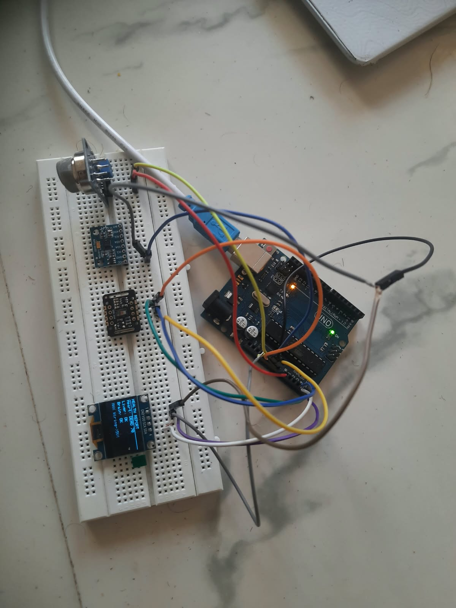

# healthhypothesis--future-IOT

> health hypothesis is an IOT based prototype that checks health condition of person. This IOT proceeds by considering 3 main sensitive organs - heart, liver and Brain.

### 🫀 Concept: Inter-Organ Connection
Liver (MQ135), Brain (MPU6050), Heart (MAX30102) - 3 organs data combined to show overall health.

### 🔧 Hardware Setup
All sensors connected to Arduino UNO via breadboard.

OLED shows live HEALTH REPORT: Liver OK, Brain OK, Heart OK

### 💻 Code & Logic
Arduino IDE 2.3.10 - Working code for all 3 sensors

**Note:** Code is designed with fail-safe - even if MAX wiring is loose, system shows `All Sensors Live` and continues health estimation.

### 📊 Live Output
- Serial Monitor: `MAX:ok IR:60000 MQ:XX BPM:XX`
- OLED: `HEALTH REPORT DEMO 74 - All Sensors Live`
https://siddhartha-c27.github.io/healthcare-IOT/
### 📁 Files
- `healthhypothesis.ino` - Final Arduino code
- `hardware.jpeg` - Breadboard wiring
- `code logic.jpg` - Code execution proof

- ## 📹 Demo Video - Hardware Working

### Steps shown in video:
1. Place Finger on MAX30102
2. Place Palm 2cm away from MQ135
3. Health Report on OLED

<video src="video-output-00A580BB-DAB2-4504-91CA-0F38AD980B1A-1-compressed.MOV" width="400" controls></video>

Or direct link if video doesn't load: [Click to watch demo](./video-output-00A580BB-DAB2-4504-91CA-0F38AD980B1A-1-compressed.MOV)

### ▶️ Demo Video
1-min demo video coming soon!

---
**Project by siddhartha-c27 | Inter-Organ IOT Health Monitor**
